<p align="center">
  
</p>

<h1 align="center">Clink themes — affiliate</h1>

<p align="center">Partner keyboard themes for Clink.</p>

Themes change the keyboard's colours, materials, type treatment, and gradients. They are ordinary JSON data, so you can read every setting before publishing a theme. These themes use each affiliate's name and colours with their permission.

## Official Clink repositories

[Language packs](https://github.com/anti-ltd/clink-language-packs) · [Layouts](https://github.com/anti-ltd/clink-layouts) · [Profiles](https://github.com/anti-ltd/clink-profiles) · [Themes](https://github.com/anti-ltd/clink-themes) · [Panels](https://github.com/anti-ltd/clink-panels) · [Actions](https://github.com/anti-ltd/clink-actions) · [Fonts](https://github.com/anti-ltd/clink-fonts) · [Sounds](https://github.com/anti-ltd/clink-sounds)

<!-- theme-gallery:start -->
## Included themes

14 keyboard themes. Select a name to open its theme file, or a preview to see it at full size.

### Solid

| | |
| --- | --- |
| <a href="Themes/threadify-dark.clinktheme"><strong>Threadify Dark</strong></a><br><a href="README-assets/previews/threadify-dark.png">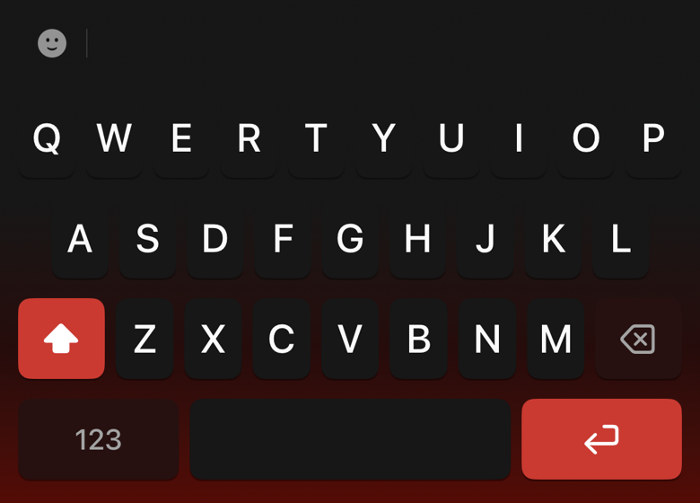</a> | <a href="Themes/threadify-light.clinktheme"><strong>Threadify Light</strong></a><br><a href="README-assets/previews/threadify-light.png">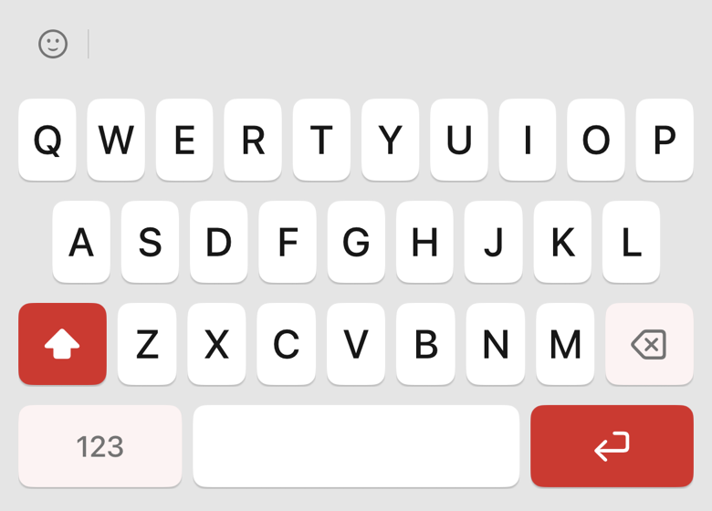</a> |

### 3D

| | |
| --- | --- |
| <a href="Themes/clicks-n-clacks-dark.clinktheme"><strong>Clicks &#x27;n Clacks Dark</strong></a><br><a href="README-assets/previews/clicks-n-clacks-dark.png">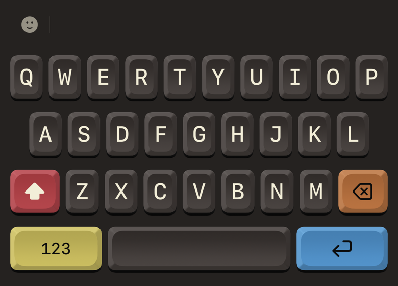</a> | <a href="Themes/clicks-n-clacks-light.clinktheme"><strong>Clicks &#x27;n Clacks Light</strong></a><br><a href="README-assets/previews/clicks-n-clacks-light.png">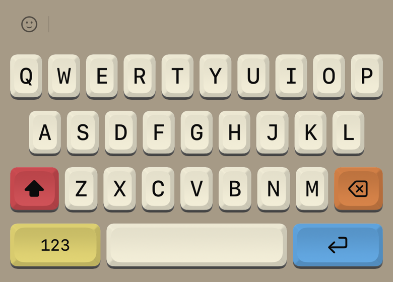</a> |
| <a href="Themes/threadflow.clinktheme"><strong>ThreadFlow Dark</strong></a><br><a href="README-assets/previews/threadflow.png">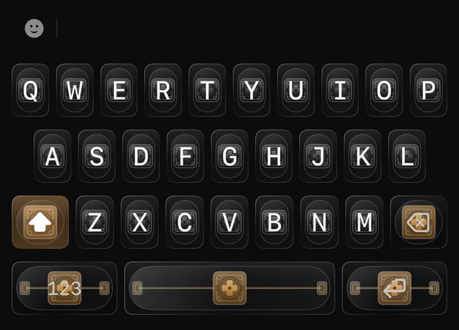</a> | <a href="Themes/threadflow-light.clinktheme"><strong>ThreadFlow Light</strong></a><br><a href="README-assets/previews/threadflow-light.png">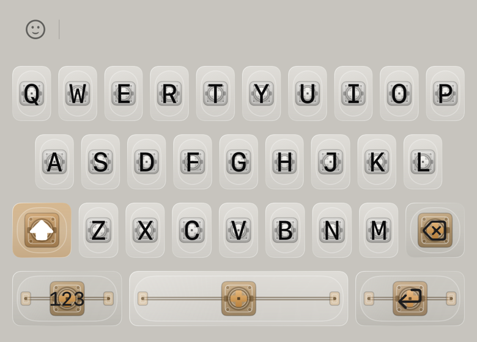</a> |

### Liquid Glass

| | |
| --- | --- |
| <a href="Themes/quiche-industries-day.clinktheme"><strong>Quiche Industries</strong></a><br><a href="README-assets/previews/quiche-industries-day.png">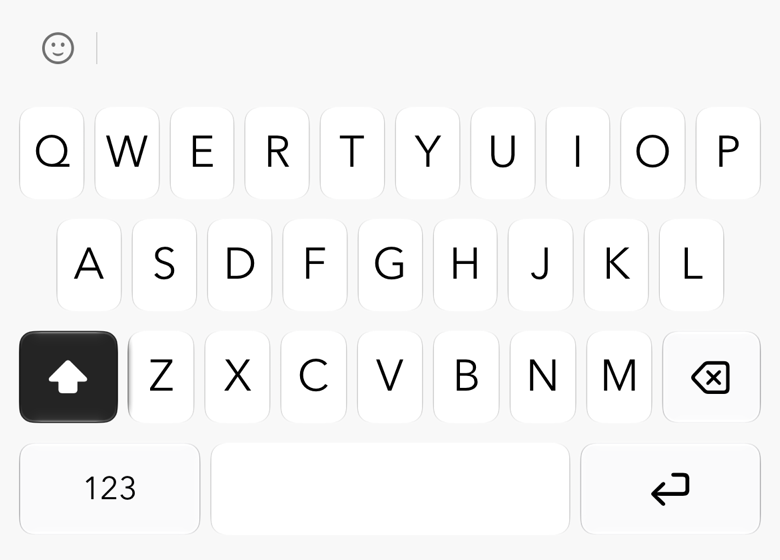</a> | <a href="Themes/quiche-industries-night.clinktheme"><strong>Quiche Industries</strong></a><br><a href="README-assets/previews/quiche-industries-night.png">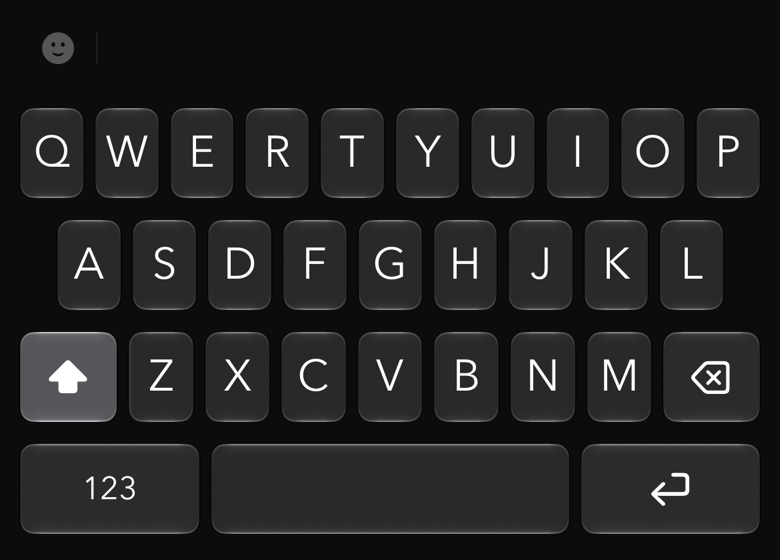</a> |

### Classic

| | |
| --- | --- |
| <a href="Themes/delphi-day.clinktheme"><strong>Delphi Day</strong></a><br><a href="README-assets/previews/delphi-day.png">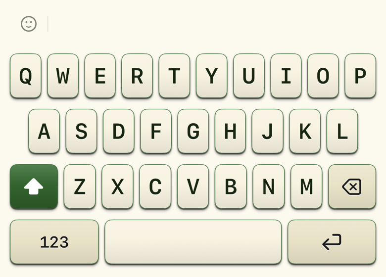</a> | <a href="Themes/delphi-night.clinktheme"><strong>Delphi Night</strong></a><br><a href="README-assets/previews/delphi-night.png">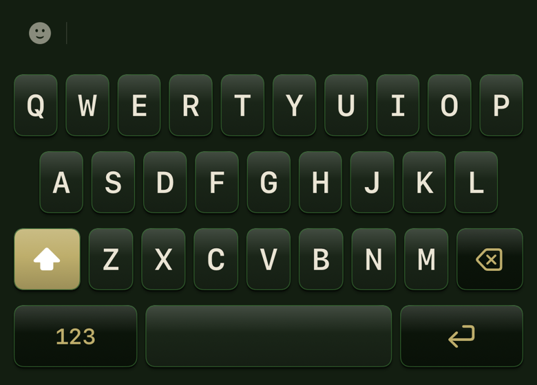</a> |

### Electronic Paper

| | |
| --- | --- |
| <a href="Themes/take-off-dark.clinktheme"><strong>Takeoff Dark</strong></a><br><a href="README-assets/previews/take-off-dark.png">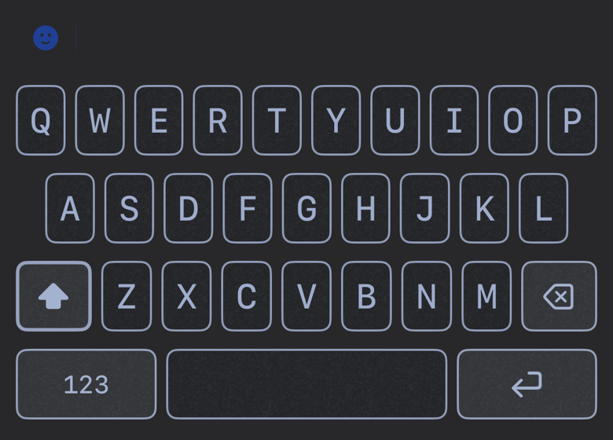</a> | <a href="Themes/take-off-light.clinktheme"><strong>Takeoff Light</strong></a><br><a href="README-assets/previews/take-off-light.png">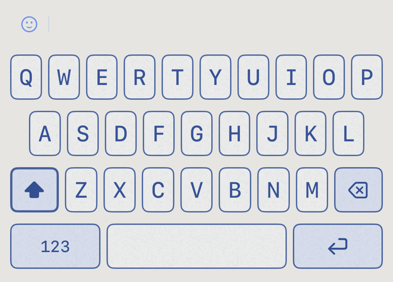</a> |

### Slab

| | |
| --- | --- |
| <a href="Themes/walley-dark.clinktheme"><strong>Walley Dark</strong></a><br><a href="README-assets/previews/walley-dark.png">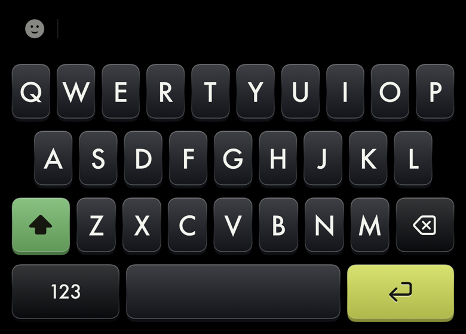</a> | <a href="Themes/walley-light.clinktheme"><strong>Walley Light</strong></a><br><a href="README-assets/previews/walley-light.png">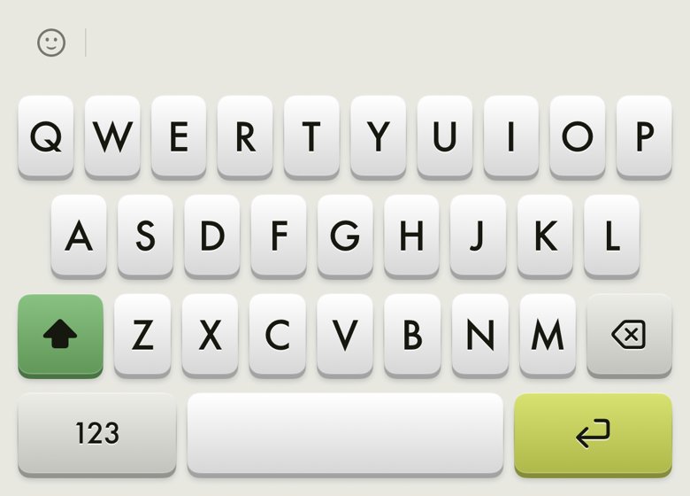</a> |


The complete collection is published under [`Themes/`](Themes). The generated [`manifest.json`](manifest.json) describes every release asset.

<!-- theme-gallery:end -->

## Use an affiliate theme

This repository is included in Clink by default. Open **Customize → Look**, choose **Affiliate** immediately after **Official**, and download a theme. Downloads and selection are free, and downloaded themes remain available offline.

Affiliate themes cannot be edited, renamed, duplicated, or exported in the app. The Affiliate repository cannot be removed. Select a theme's ⓘ to read about the affiliate and follow its website link.

## Make your first affiliate theme

1. Obtain the affiliate's written permission to use its name and material.
2. Create a theme in Clink and choose **Export** from the theme menu to save a `.clinktheme` file.
3. Put the file in [`Themes/`](Themes), with a permanent lowercase `id` matching its filename and a clear visible `name`.
4. Do not include `backgroundImageID` or `keyImageID`. Repository themes can contain colours, gradients, materials, and fonts, but not image files.
5. Add the approved affiliate's website and description to [`links.json`](links.json), if applicable.
6. Run these commands:

   ```sh
   python3 -m unittest discover -s tests
   python3 tools/build-manifest.py
   python3 -m json.tool manifest.json >/dev/null
   ```

7. Inspect the theme in Clink before publishing. Push approved changes to `main` to publish a versioned release automatically.

Do not add placeholder or sample themes. See [design notes](DESIGN.md) for the existing affiliates' palettes, materials, and typography.

## Make a theme with an AI agent

This repository includes [`PROMPT.md`](PROMPT.md), a brief for an AI coding agent. Once the affiliate is approved, open the repository in your agent and say:

```text
Read PROMPT.md and create a theme for [approved affiliate and visual direction].
```

Review the resulting JSON, attribution, and appearance in Clink before publishing. The repository license’s third-party terms apply to separately licensed content.

## What Clink verifies

Clink accepts only public HTTPS GitHub release manifests. Each theme must come from that repository's release, be a `.clinktheme` JSON file no larger than 128 KB, and match the SHA-256 hash and byte count in the manifest.

Clink downloads each file into a temporary directory, verifies its checksum and safe data-only structure, and only then installs it. Themes cannot contain photos or executable code.

Adding a repository is a trust decision. Only add repositories whose release contents you trust.

## Permission

Every theme here uses its affiliate's name, and in most cases their colors, **with that affiliate's permission** — several asked specifically that this be visible rather than assumed. The app says so in the sheet behind a theme's ⓘ, and only for themes from this repository: a community repository can publish a link too, and its author is a publisher, not an affiliate. Do not add a theme here until that permission exists in writing.

## Links

`links.json` at the repository root maps a theme id to an `https://` URL — either bare, or as `{"url": …, "description": …}` — and `tools/build-manifest.py` merges them into that theme's manifest entry as `link` and `description`. A description is one paragraph, at most 240 characters, no line breaks. Themes absent from the file carry no link, which is the normal case. A link is metadata rather than theme bytes, so adding or changing one never moves the release version and cached manifests keep resolving to the assets they were published with. The build fails on an id that is not in `Themes/` and on any URL that is not `https://`.

In the app an ⓘ on the theme's catalog tile opens a card naming the publisher, showing the description and offering one button to the site. The tap itself opens nothing. Write the description as the affiliate would say it out loud.

## Publishing is automatic

Keep `Themes/`, `tools/`, `tests/`, and `.github/workflows/` in your fork. Add or update an approved theme, regenerate the manifest, and push to `main`. GitHub Actions runs the manifest tests, builds the manifest, and publishes a versioned release. You can also run the workflow manually through Actions.

Each distinct asset set receives a permanent content-derived release tag. Published assets and previous releases are retained so cached manifests continue to verify. Clink discovers updates through the latest release's `manifest.json`. Do not delete older releases while clients may still have their manifests.

Local manifest builds default to `anti-ltd/clink-themes-affiliate`. For a fork, set `GITHUB_REPOSITORY=owner/repository` when running the builder. GitHub Actions uses the actual repository name automatically.

## Refresh the previews

Run `ThemeRepositoryGalleryTests` in the Clink app's simulator test host and export its xcresult attachments, then run:

```sh
python3 -m pip install Pillow
python3 tools/update-readme-gallery.py /path/to/exported-attachments
```

The gallery uses Clink's production keyboard renderer. [`README-assets/preview-manifest.json`](README-assets/preview-manifest.json) records the theme and preview checksums for each capture.

## Platform availability

`platforms.json` sets the default platform for packs in this repository and optional overrides keyed by pack ID (language code or locale for language packs). Use `ios`, `android`, or `both`. The manifest builder writes `platform` on every entry; older entries without it mean `both`. Platform targeting affects repository discovery and downloads, not the portable format of a person’s own exported content.

Quiche Industries day and night are iOS-only at the publisher’s request. Every other pack is available on both platforms.
